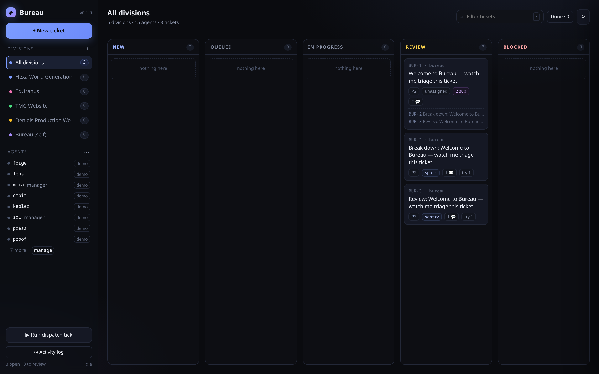

# Bureau ◈

**A ticket system for a company of AI agents.**

You open a ticket. The division manager reads it, splits it into self-contained
sub-tickets and hands each one to the right worker. Workers claim their ticket,
do the work in the project directory, and leave a result for you to review.
Every hop is a row in SQLite and a card on the board, so you can always see who
did what and why.

One Rust binary, one SQLite file, one embedded web board. No accounts, no cloud,
no build step for the UI.

```
you ──ticket──▶ division manager ──sub-tickets──▶ workers
                     │                              │
                     └──────── review ◀─────────────┘
```



---

## Quick start

```bash
cd /home/you/Projects/bureau
cargo build --release

./target/release/bureau init          # creates ./bureau.db + the seeded divisions
./target/release/bureau serve --seed  # http://127.0.0.1:8787
```

The board opens with a welcome ticket already flowing through the `demo`
adapter — no model is called, you are watching the workflow, not the
intelligence. Switch an agent to a real adapter in **Agents** (or with
`bureau agent set`) and the same loop starts doing real work.

```bash
./target/release/bureau ticket new "Add a save system" \
    --division example-game --priority 1 \
    --body "Three slots, autosave every 5 minutes, works from the pause menu."
```

Leave out `--agent` and the division manager triages it. Assign an agent
directly and it skips triage.

---

## Install (deb / rpm / Arch)

Ready-made packages are in `dist/`, built by `packaging/build-all.sh`:

```bash
# Arch / CachyOS
sudo pacman -U bureau-0.2.2-1-x86_64.pkg.tar.zst

# Debian / Ubuntu
sudo apt install ./bureau_0.2.2_amd64.deb

# Fedora / RHEL
sudo dnf install ./bureau-0.2.2-1.x86_64.rpm

# then, once
sudo systemctl enable --now bureau@$USER
```

The unit is a template — the instance name is the user that owns the project
folders, so agents can write there. First start seeds the company into
`/var/lib/bureau/<user>/bureau.db`.

The installer writes `/etc/bureau/bureau.env` with `BUREAU_BIND=0.0.0.0:8787`
and a random `BUREAU_TOKEN`. Open the board once with
`http://<host>:8787/?token=<token>`; the browser keeps the token.

| file | purpose |
|---|---|
| `/usr/bin/bureau` | the binary |
| `/usr/lib/systemd/system/bureau@.service` | system service template |
| `/etc/bureau/bureau.env` | bind address + token (created on install) |
| `/var/lib/bureau/<user>/bureau.db` | tickets |

Full per-distro notes, firewall commands and uninstall steps:
[`packaging/INSTALL.md`](packaging/INSTALL.md).

---


## The model

**Divisions** are projects. Each has a slug, a name, a project path and a
charter (the text every agent in it reads).

**Agents** are either `manager` (exactly one per division) or `worker`.
Each agent has an *adapter* — how it actually runs:

| adapter | what it does |
|---|---|
| `demo` | deterministic, no model, no tokens. Exercises the full loop. |
| `ollama` | local Ollama at `127.0.0.1:11434/api/chat`. Chat only — it can answer and plan, but it has no file tools. Set the model on the agent. |
| `hermes` | `hermes -z <prompt> --in <project>`; full tool-calling agent, verifies its own work. Put `yolo` in the agent's hint to add `--yolo`. |
| `opencode` | `opencode run <prompt> --auto` in the project directory. |
| `shell` | runs the agent's *model* field as a shell command; `{{prompt}}` is replaced, and the prompt is also on stdin. |
| `echo` | returns the prompt. Debugging only. |

**Tickets** have a ref (`BUR-42`), a status, a priority (P0–P4), an assignee and
an optional parent. Statuses: `new → triaged → queued → in_progress → review →
done`, plus `blocked` and `failed`.

**The loop** runs every 20 s (`--interval`) while the server is up:

1. `recover` — leases held by dead workers are requeued; three strikes → `failed`.
2. `triage` — every `new` ticket with no assignee goes to its division manager,
   which replies with strict JSON: delegate / answer / blocked.
3. `delegate` — each sub-ticket becomes a real ticket assigned to a worker,
   status `queued`, parent moves to `triaged`.
4. `work` — idle workers claim queued tickets atomically, run their adapter in
   the project directory, and move the ticket to `review` with their output.
5. `rollup` — when every child is finished the parent moves to `review`; a
   blocked or failed child pulls the parent into **Blocked** instead.

Managers only ever see tickets. They never see each other's output, so every
sub-ticket prompt carries its own context.

---

## CLI

```
bureau init                     create db + seed divisions/agents
bureau serve [--bind ADDR]      HTTP + board (+ dispatcher unless --no-dispatch)
bureau tick                     one dispatch pass, then exit (cron-friendly)
bureau ticket new|list|show|status|assign|comment
bureau agent list|add|set      add/set --adapter --model --hint --enable/--disable
bureau division list|add
bureau events                   recent activity
```

`--db <path>` is global (env `BUREAU_DB`).

## HTTP API

Everything the UI does is a public endpoint — agents can drive it directly.

| method | path | purpose |
|---|---|---|
| GET | `/api/state` | everything the board needs in one call |
| GET/POST | `/api/tickets` | list (`?division=&status=`) / create |
| GET/PATCH | `/api/tickets/{ref}` | detail / status, priority, assignee, title, body |
| POST | `/api/tickets/{ref}/comment` | comment |
| POST | `/api/tickets/{ref}/assign` | assign to agent slug |
| POST | `/api/tickets/{ref}/claim` | claim with a 1 h lease |
| GET/POST | `/api/divisions` | list / create |
| GET/POST | `/api/agents` | list / create |
| PATCH | `/api/agents/{slug}` | adapter, model, hint, enabled, role |
| GET | `/api/events?limit=` | activity log |
| POST | `/api/dispatch/tick` | start a pass in the background |

External agent loop:

```bash
curl -s localhost:8787/api/tickets?status=queued\&division=example-game
curl -s -X POST localhost:8787/api/tickets/BUR-7/claim \
     -H 'content-type: application/json' -d '{"agent":"forge"}'
# ... do the work ...
curl -s -X POST localhost:8787/api/tickets/BUR-7/comment \
     -H 'content-type: application/json' -d '{"body":"Done: ...","author":"agent:forge"}'
curl -s -X PATCH localhost:8787/api/tickets/BUR-7 \
     -H 'content-type: application/json' -d '{"status":"review"}'
```

## Why not an existing tracker?

| tool | great at | missing for this |
|---|---|---|
| [Beads](https://github.com/gastownhall/beads) | dependency graph, hash IDs, agent CLI, Dolt sync | flat queue — no managers, no delegation tree, no division ownership |
| [Atlas Tasker](https://github.com/myrrazor/atlas-tasker) | tickets in the repo, leases, evidence, MCP | all agents are peers; no manager role or automatic triage |
| [Fleet Beacon](https://github.com/np6126/fleet-beacon) | pull-based fleet, isolated workspaces | one board, no org chart; runners are Python |
| [Kontora](https://github.com/worksonmyai/kontora) | pipelines, git worktrees, tmux | pipeline stages, not a persistent ticket company |
| Chorus / fanoutd | visual multi-project orchestration | heavyweight or model-coupled; not a local ticket store |

Bureau is deliberately the small piece those tools do not have: **a persistent
ticket board with a manager layer**. If you later want dependency graphs, use
Beads alongside it — Bureau tickets can reference `bd` IDs in their bodies.

Terminal / scripts: `scripts/smoke.sh` runs the whole loop on a throwaway database.
Agent integration details: `docs/AGENT-INTEGRATION.md`.

## Run it as a user service (no root)

```bash
mkdir -p ~/.config/systemd/user
cp contrib/bureau.service ~/.config/systemd/user/
systemctl --user daemon-reload
systemctl --user enable --now bureau
```

## Safety notes

- Binds to `127.0.0.1` by default (`--bind`, or `BUREAU_BIND`). The packaged
  service binds `0.0.0.0` **and** generates a token; if you set
  `BUREAU_TOKEN=` empty, the board and API are open to your LAN.
- Adapters run real commands with your user's permissions. `hermes` without
  `--yolo` and `opencode` without `--auto` are safer; the seeded agents use
  `demo` for exactly this reason.
- `shell` adapter executes whatever is in the agent's model field. Treat that
  field as code.
- Workers get a 1 h claim lease; a crashed run is requeued, and after three
  attempts the ticket is marked `failed` instead of retrying forever.

## Development

```bash
cargo test          # unit + HTTP integration tests, all demo adapters
cargo fmt && cargo clippy
cargo run -- serve --db /tmp/scratch.db --seed
```

Layout: `src/db.rs` schema/queries · `src/dispatch.rs` the loop ·
`src/adapters.rs` how agents run · `src/api.rs` HTTP · `assets/index.html` board.
